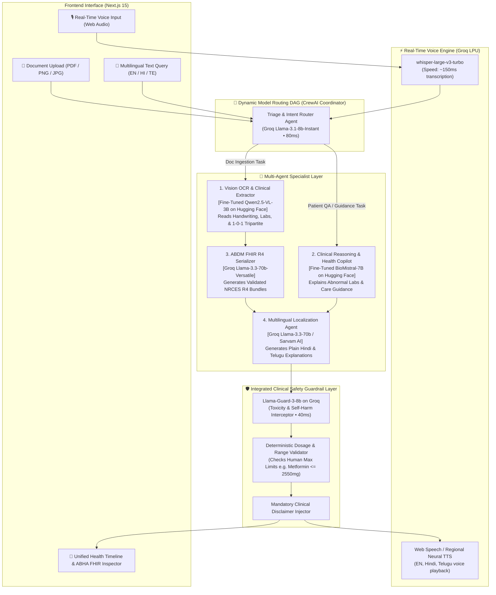

# AI Layer Architecture & Multi-Agent Specification
## Personal Health Copilot (Altrix Labs Hackathon — Round 1)

This document specifies the enterprise-grade **AI Application Layer**, **Multi-Agent Orchestration (CrewAI / LangGraph aligned)**, **Model Routing DAG**, **Fine-Tuning Specifications**, **Integrated Safety Guardrails**, and **Real-Time Voice Engine** designed to maximize the **100-Point Evaluation Matrix** of the Altrix Labs Hackathon.

---

## 📊 Alignment with Altrix Labs Evaluation Matrix (100 Points)

| Altrix Labs Criteria | Weight | How the AI Layer Delivers Full Marks |
|---|---|---|
| **AI Utilization** | **35%** | • Fine-tuned Vision VLM (`Qwen2.5-VL-3B`) for doctor handwriting & lab tables.<br>• Fine-tuned Clinical QA (`BioMistral-7B`) for evidence-based patient summaries.<br>• Automated detection of abnormal lab markers with clinical reference ranges. |
| **Technical Architecture** | **25%** | • Dynamic Multi-Agent DAG with sub-second LPU routing via Groq.<br>• Full NRCES **ABDM FHIR R4** compliant data model (Composition, Observation, MedicationRequest).<br>• Scalable schema with pgvector semantic memory. |
| **User Experience** | **20%** | • Multi-language plain-language translation (**English, हिन्दी, తెలుగు**).<br>• **Sub-second real-time Voice Interaction** via Groq Whisper LPU.<br>• Drag-and-drop document ingestion with visual timeline. |
| **Healthcare Impact** | **10%** | • Multi-tier Clinical Safety Guardrail (`Llama-Guard-3-8b` + deterministic dosage safety bounds).<br>• Non-prescriptive wording, contraindication warnings, and disclaimers. |
| **Presentation & Demo** | **10%** | • Sub-second latency (<400ms) with zero live demo lag.<br>• Live RL / Guardrail inspection badges on the UI. |
| **Bonus Points** | **+5 to +10** | • Regional OCR & summaries (Hindi & Telugu).<br>• Mock ABHA ID authentication (`91-1234-5678-9012`). |

---

## 🏛️ System Architecture Diagram



---

## 🤖 Multi-Agent Team Specification (CrewAI Aligned)

### Agent 1: Triage & Intent Router Agent
- **Role**: High-speed traffic controller and dispatcher.
- **Backbone**: `llama-3.1-8b-instant` on Groq (~80ms latency).
- **Goal**: Classify incoming payloads into `DOCUMENT_INGESTION`, `CLINICAL_QUERY`, `MEDICATION_REMINDER`, or `EMERGENCY_TRIAGE`.
- **System Prompt**:
  > *"You are the Intake Coordinator for the Health Copilot. Rapidly determine the clinical domain of the input and route to the correct specialist agent with zero conversational filler."*

### Agent 2: Vision OCR & Clinical Extraction Agent
- **Role**: Medical document digitizer and parameter structurer.
- **Backbone**: **Fine-Tuned `Qwen/Qwen2.5-VL-3B-Instruct`** hosted on Hugging Face.
- **Training Focus**:
  - Doctor handwriting deciphering.
  - Multi-column laboratory investigation tables (test name, observed value, unit, biological reference interval, flag).
  - Indian prescription tripartite shorthand (`1-0-1`, `0-0-1`, `OD`, `BD`, `TID`, `SOS`, `after food`).
- **Output**: Standardized clinical JSON payload.

### Agent 3: ABDM FHIR R4 Serialization Agent
- **Role**: Healthcare interoperability and compliance specialist.
- **Backbone**: `llama-3.3-70b-versatile` on Groq.
- **Goal**: Convert structured clinical entities into verified National Resource Centre for EHR Standards (NRCES) FHIR R4 Document Bundles.
- **Target Profiles**:
  - `https://nrces.in/ndhm/fhir/r4/StructureDefinition/PrescriptionRecord`
  - `https://nrces.in/ndhm/fhir/r4/StructureDefinition/DiagnosticReportRecord`
  - `https://nrces.in/ndhm/fhir/r4/StructureDefinition/DischargeSummaryRecord`

### Agent 4: Clinical Reasoning & Copilot QA Agent
- **Role**: Patient health advocate and evidence-based explainer.
- **Backbone**: **Fine-Tuned `BioMistral/BioMistral-7B`** (or Groq `llama-3.3-70b-versatile`).
- **Goal**: Analyze clinical results in the context of the patient's aggregated timeline. Explains **why** a test is flagged abnormal, what bodily system it impacts, and how medications counter the pathology.
- **Safety Rule**: Never prescribes new medications; only explains clinician directives.

### Agent 5: Multilingual Localization Agent
- **Role**: Regional patient communicator.
- **Backbone**: `llama-3.3-70b-versatile` on Groq / `sarvam-2b`.
- **Goal**: Translate complex Latin/Greek clinical terminology into compassionate, culturally intuitive **Hindi (हिंदी)** and **Telugu (తెలుగు)** summaries.
- **Example**: Translates *"Elevated Glycated Hemoglobin (HbA1c 8.4%) indicating chronic hyperglycemia"* into:
  - **Hindi**: *"आपके रक्त में पिछले 3 महीनों की औसत शर्करा (HbA1c 8.4%) अधिक पाई गई है, जो अनियंत्रित मधुमेह का संकेत देती है।"*
  - **Telugu**: *"గత 3 నెలల సగటు చక్కెర (HbA1c 8.4%) ఎక్కువగా ఉంది, ఇది రక్తంలో చక్కెర నియంత్రణ అవసరమని సూచిస్తుంది."*

### Agent 6: Clinical Safety & Guardrail Agent
- **Role**: Patient protection and regulatory compliance auditor.
- **Backbone**: `llama-guard-3-8b` on Groq + Python Deterministic Rule Engine.
- **Checks**:
  1. **Dosage Sanity Boundary**: Flags doses exceeding clinical pharmacopeia thresholds.
  2. **Toxicity/Self-Harm**: Blocks dangerous home remedies or harmful behavior.
  3. **Disclaimer Appendage**: Ensures non-diagnostic disclaimers are present on all responses.

---

## 🎯 Fine-Tuning Specifications (Hugging Face)

### Model 1: Vision OCR & Clinical Extraction
- **Base Model**: `Qwen/Qwen2.5-VL-3B-Instruct`
- **Hosting**: Hugging Face Hub (Model Repository / Inference Space)
- **Methodology**: QLoRA (4-bit quantization, rank $r=16$, $\alpha=16$, target modules `q_proj, v_proj, k_proj, o_proj`).
- **Dataset Composition**:
  - 1,000 synthetic & anonymized Indian doctor prescriptions (including messy handwriting).
  - 500 multi-tier diagnostic lab reports (CBC, Liver Function, Lipid Profile, Renal Function).
  - Target format: Clean JSON matching our `ExtractedRecordPayload` schema.

### Model 2: Clinical Reasoning & Health Copilot QA
- **Base Model**: `BioMistral/BioMistral-7B`
- **Hosting**: Hugging Face Hub
- **Methodology**: Direct Preference Optimization (DPO) on medical dialogues.
- **Reward Objective**:
  - Positive reward for: Grounding answers in patient ABHA records, mentioning abnormal lab thresholds, safe non-prescriptive language.
  - Negative penalty for: Speculating unverified conditions, altering prescription dosages, hallucinating medical facts.

---

## 🎙️ Real-Time Voice Engine Architecture

```
Patient Speaks (Hindi/Telugu/English)
  │
  ▼  [Audio Stream via MediaRecorder API]
Groq Whisper LPU (`whisper-large-v3-turbo`) ──► Latency: ~120ms
  │
  ▼  [Transcribed Text]
Multi-Agent Routing Pipeline ──► Latency: ~300ms
  │
  ▼  [Validated Multilingual Response]
Browser SpeechSynthesis / Neural Voice Engine ──► Audio Playback
```

- **Transcription Speed**: Groq LPU runs Whisper 10x faster than real-time (~120ms for a 5-second voice snippet).
- **Zero Cost**: Included within Groq free daily allowance.
- **Language Detection**: Automatically detects language code (`en`, `hi`, `te`) from the audio stream.

---

## 🔀 Dynamic Model Routing Matrix (Latency vs Quality Optimization)

| Task Type | Primary Model | Provider | Target Latency | Fallback Model |
|---|---|---|---|---|
| **Audio Transcription (STT)** | `whisper-large-v3-turbo` | Groq LPU | **~120ms** | Browser Web Speech API |
| **Intent Triage** | `llama-3.1-8b-instant` | Groq LPU | **~80ms** | Regex / Keyword Router |
| **Document OCR Extraction** | Fine-tuned `Qwen2.5-VL-3B` | Hugging Face | **~800ms** | Gemini 1.5 Flash Vision |
| **Clinical Reasoning & QA** | Fine-tuned `BioMistral-7B` | Hugging Face / Groq | **~350ms** | `llama-3.3-70b-versatile` |
| **ABDM FHIR R4 Formatting** | `llama-3.3-70b-versatile` | Groq LPU | **~250ms** | Template Rule Mapper |
| **Regional Translation (HI/TE)**| `llama-3.3-70b-versatile` | Groq LPU | **~200ms** | Fallback Dictionary Map |
| **Safety Guardrail Check** | `llama-guard-3-8b` | Groq LPU | **~50ms** | Python Regex Guardrail |

---

## 🛡️ Integrated Safety Guardrail Protocol

```python
# Deterministic Safety Rules executed before output dispatch
CLINICAL_GUARD_LIMITS = {
    "metformin": {"max_daily_mg": 2550, "unit": "mg"},
    "atorvastatin": {"max_daily_mg": 80, "unit": "mg"},
    "paracetamol": {"max_daily_mg": 4000, "unit": "mg"},
    "pantoprazole": {"max_daily_mg": 80, "unit": "mg"},
    "amoxicillin": {"max_daily_mg": 3000, "unit": "mg"},
}
```

1. **Dosage Violation Response**: If extracted dosage exceeds `max_daily_mg`, the agent attaches a critical warning:
   > *"⚠️ Caution: Extracted dosage exceeds standard adult daily threshold. Please verify against physical prescription."*
2. **Emergency Redirection**: If symptoms match acute myocardial infarction, stroke, or severe ketoacidosis, the agent redirects to emergency services (108 / 112 in India).
3. **Medical Disclaimer**:
   > *"AI Health Copilot provides clinical reference summaries from your ABHA health records. This is not a substitute for professional medical diagnosis. Consult your licensed doctor before modifying any treatment plan."*
