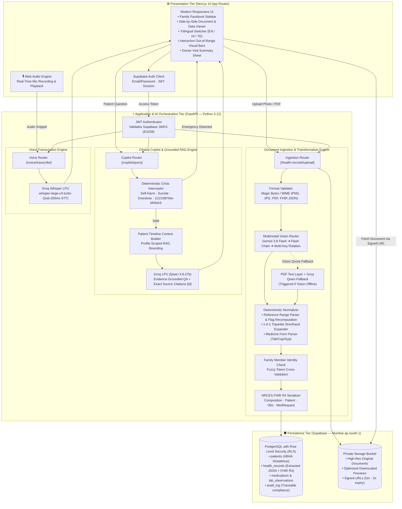
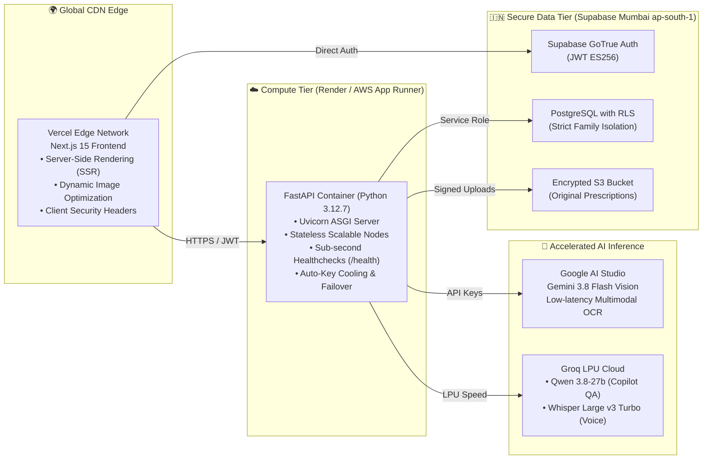

# 🩺 Personal Health Copilot
### Intelligent Family Health Passbook & Clinical Intelligence Engine (ABDM FHIR R4 Ready)

[](https://altrixlabs.com)
[](https://nextjs.org)
[-009688?style=for-the-badge&logo=fastapi)](https://fastapi.tiangolo.com)
[](https://deepmind.google/technologies/gemini/)
[-F55036?style=for-the-badge)](https://groq.com)
[](https://supabase.com)
[](https://nrces.in)

> **Built for the Altrix Labs "AI-Powered Personal Health Copilot" Hackathon.**  
> Transforms unstructured Indian paper prescriptions, handwritten doctor notes, complex diagnostic lab reports, and hospital discharge summaries into structured, verified, trilingual health intelligence (**English, हिन्दी, తెలుగు**), mapped directly to India's **ABDM FHIR R4** standards.

---

## 📑 Table of Contents
1. [Domain Problem & Vision](#-domain-problem--vision)
2. [End-to-End System Architecture](#-end-to-end-system-architecture)
3. [Deployment Architecture](#-deployment-architecture)
4. [AI Layer & Multi-Agent Intelligence](#-ai-layer--multi-agent-intelligence)
5. [Core Features & Differentiators](#-core-features--differentiators)
6. [Data Model & Security (RLS)](#-data-model--security-rls)
7. [Local Setup & Installation](#-local-setup--installation)
8. [Live Hackathon Demo Script](#-live-hackathon-demo-script)
9. [Clinical Safety & Guardrails](#-clinical-safety--guardrails)
10. [Hackathon Evaluation Alignment (100 Points)](#-hackathon-evaluation-alignment-100-points)

---

## 🌐 Domain Problem & Vision

### The Caregiver Reality in India
In Indian households, health management is predominantly **multigenerational and caregiver-driven**. An adult son or daughter typically manages paper health records for elderly parents, children, and themselves.

```
       [ Chaotic Reality ]                               [ Personal Health Copilot ]
┌─────────────────────────────────┐               ┌─────────────────────────────────────────┐
│ • Crinkled paper prescriptions  │               │ • One unified digital Family Passbook   │
│ • Unreadable doctor handwriting │               │ • High-accuracy Multimodal Vision OCR   │
│ • Complex lab reports with rows │  ────────►    │ • Deterministic Reference Range Check   │
│ • Shorthand notation (1-0-1, OD)│   AI ENGINE   │ • Trilingual Parity (English/Hindi/Tel) │
│ • Faded discharge summaries     │               │ • Grounded Copilot with Exact Citations │
│ • Panic over medical terms      │               │ • NRCES-compliant ABDM FHIR R4 Export   │
└─────────────────────────────────┘               └─────────────────────────────────────────┘
```

### The Three Critical Clinical Bottlenecks
1. **The "Hallucination Trap" in Healthcare**: Standard generative AI systems often guess whether a test value is normal based on training data. A blood sugar level of 140 mg/dL may be normal postprandial, but high fasting. *Health Copilot recomputes flags directly from the printed reference range on the paper*, refusing to let AI hallucinate clinical normality.
2. **Medical Shorthand & Linguistic Barriers**: Prescriptions use shorthand like `Tab Metformin 500mg 1-0-1 after food`. Families struggling with medical jargon or English deserve explanations in their native language (**Hindi** or **Telugu**) that explain *how* and *when* to take medications.
3. **Identity Fragmentation & Cross-Contamination**: Storing parents' cardiac medications in the same folder as a child's pediatric records causes dangerous confusion. Health Copilot isolates records by family member, validates patient names, and alerts caregivers immediately if a document belongs to someone else.

---

## 🏛️ End-to-End System Architecture



---

## 🚀 Deployment Architecture

The entire stack is configured for enterprise resilience, high availability, and zero data leakage across cloud providers:



### Deployment Configuration Summary

| Layer | Platform | Location / Region | Key Features |
|---|---|---|---|
| **Frontend** | **Vercel** | Global Edge | Next.js 15 App Router, Tailwind CSS, lucide icons, responsive mobile-first UI. |
| **Backend API** | **Render / AWS App Runner** | Singapore / Mumbai | Dockerized FastAPI, Uvicorn, automated rate-limit retry with multi-key cooldowns. |
| **Database & Auth** | **Supabase** | `ap-south-1` (Mumbai, India) | PostgreSQL with strict Row Level Security (RLS), Encrypted Private Buckets. |
| **AI Vision** | **Google Gemini** | Distributed | Multimodal Vision OCR (`gemini-3.8-flash` with 4-level fallback). |
| **AI LLM & STT** | **Groq LPU** | Ultra-Low Latency | `qwen/qwen3.8-27b` for clinical reasoning, `whisper-large-v3-turbo` for voice. |

---

## 🧠 AI Layer & Multi-Agent Intelligence

*(For in-depth specifications, prompt templates, and evaluation benchmarks, see [AI_LAYER.md](AI_LAYER.md))*

```
┌─────────────────────────────────────────────────────────────────────────────┐
│                            AI INGESTION PIPELINE                            │
│                                                                             │
│  [ Upload ] ──► [ MIME & Magic Check ] ──► [ Gemini 3.8 Vision OCR ]        │
│                                                      │ (quota fail)         │
│                                                      ▼                      │
│                                             [ PDF Text + Groq Qwen ]        │
│                                                      │                      │
│                                                      ▼                      │
│  [ ABDM FHIR R4 ] ◄── [ Regex Normalizer ] ◄── [ Non-Medical Filter ]       │
│         │               • Range flags                                       │
│         ▼               • 1-0-1 Shorthand                                   │
│  [ Family Store ]       • Tab/Cap forms                                     │
└─────────────────────────────────────────────────────────────────────────────┘
```

1. **Multimodal Document OCR**: Reads messy doctor handwriting, multi-column lab tables, and bilingual English/Hindi scripts.
2. **Deterministic Range Verification**: Biological reference ranges printed on the report (e.g. `70 - 99 mg/dL`) are extracted and mathematically checked against observed values. **The AI's opinion never decides whether a value is HIGH or LOW.**
3. **Tripartite Shorthand Expander**: Indian doctor shorthand like `1-0-1` is expanded into `"1 morning, 0 afternoon, 1 night (twice daily) after food"`.
4. **Trilingual Parity Engine**: High-fidelity plain-language summaries, pill instructions, abnormal value explanations, and questions for the doctor generated in **English, Hindi, and Telugu**.
5. **Grounded Copilot RAG**: The assistant operates exclusively over the selected family member's records and outputs bracketed citations `[ab12cd34]` linking every medical statement to its physical source.

---

## ✨ Core Features & Differentiators

### 1. Side-by-Side Source Verification
Every extracted value is presented alongside the high-resolution original image or PDF. Clicking an observation highlights the source, ensuring 100% human-in-the-loop auditability.

### 2. Multi-Generational Family Passbook
A single caregiver account can manage multiple family profiles (e.g., Mother, Father, Self, Child).
- **Name Mismatch Warning**: If a document uploaded to "Lakshmi Devi" contains the printed name "Suresh Yadav", the system flags:
  > *"⚠️ This document names Suresh Yadav, but is filed under Lakshmi Devi."*
- **One-Click Reassignment**: Moves the document to the right profile and regenerates the FHIR bundle instantly.

### 3. ABDM FHIR R4 Standard Compliance
- Maps every document to **NRCES (National Resource Centre for EHR Standards)** profiles:
  - `PrescriptionRecord`
  - `DiagnosticReportRecord`
  - `DischargeSummaryRecord`
- Supports ABHA number (`91-1234-5678-9012`) and ABHA address (`name@abdm`) validation.
- Full **FHIR R4 Bundle Export** and **Bidirectional FHIR Import** (drop an ABDM JSON file to parse into the visual timeline).

### 4. Interactive Range Sliders & Visual Timeline
Out-of-range lab markers feature interactive range bars showing where the patient's value sits relative to low, normal, and high bounds.

### 5. Printable Doctor Visit Summary
One-click printable clinical handoff sheet summarizing:
- Current active medications and frequencies.
- Out-of-range lab values with printed reference ranges.
- Suggested questions to ask the doctor during the consultation.

### 6. Sub-second Multilingual Voice Assistant
Speak questions in English, Hindi, or Telugu using Groq Whisper LPU (~150ms transcription latency).

---

## 🗄️ Data Model & Security (RLS)

All database operations are governed by **PostgreSQL Row-Level Security (RLS)** in `supabase/migrations/20261012170000_health_copilot.sql`.

```
                    ┌─────────────────────────┐
                    │      auth.users         │
                    └────────────┬────────────┘
                                 │ owns (1:N)
                                 ▼
                    ┌─────────────────────────┐
                    │        patients         │
                    │   (Family Profiles)     │
                    └────────────┬────────────┘
                                 │ has many (1:N)
                                 ▼
                    ┌─────────────────────────┐
                    │     health_records      │
                    │  (Extracted JSON/FHIR)  │
                    └────────────┬────────────┘
         ┌───────────────────────┼───────────────────────┐
         ▼                       ▼                       ▼
┌─────────────────┐     ┌─────────────────┐     ┌─────────────────┐
│   medications   │     │lab_observations │     │   conditions    │
└─────────────────┘     └─────────────────┘     └─────────────────┘
```

- **Identity Isolation**: Every row has an `owner_id`. Users can never query or view records belonging to another caregiver.
- **Private Storage**: Original documents are stored under `<owner_id>/<record_id>` in private Supabase Storage buckets.
- **Short-Lived Signed URLs**: Pre-signed URLs expire after 1 hour; previews are cached for instant navigation.
- **Audit Logging**: Every view of an original document, upload, delete, and export is recorded in `audit_log`.

---

## 💻 Local Setup & Installation

### Prerequisites
- Python 3.12+
- Node.js 18+ & npm
- Free API Keys: [Google AI Studio](https://aistudio.google.com/) and [Groq Console](https://console.groq.com/)
- Free [Supabase](https://supabase.com) project (or run with mock fallback)

### 1. Backend Setup
```bash
cd backend
python -m venv venv

# Windows
.\venv\Scripts\activate
# Linux / macOS
source venv/bin/activate

pip install -r requirements.txt
cp .env.example .env
```

Configure your `backend/.env`:
```env
PROJECT_NAME="AI-Powered Personal Health Copilot"
API_V1_PREFIX="/api/v1"

# AI Inference Keys
GEMINI_API_KEY="AIzaSy..."
GEMINI_API_KEY_FALLBACK="AIzaSy..." # Optional: secondary key for auto-failover
GROQ_API_KEY="gsk_..."

# Supabase Configuration
SUPABASE_URL="https://<your-project>.supabase.co"
SUPABASE_KEY="sb_secret_..."
SUPABASE_PUBLISHABLE_KEY="sb_publishable_..."
SUPABASE_JWKS_URL="https://<your-project>.supabase.co/auth/v1/.well-known/jwks.json"
FRONTEND_ORIGIN="http://localhost:3000,http://localhost:3010"
```

Start the backend:
```bash
uvicorn app.main:app --reload --port 8000
```
*Verify backend health: `http://localhost:8000/health`*

### 2. Frontend Setup
```bash
cd ../frontend
npm install
cp .env.example .env.local
```

Configure `frontend/.env.local`:
```env
NEXT_PUBLIC_BACKEND_URL="http://localhost:8000/api/v1"
NEXT_PUBLIC_SUPABASE_URL="https://<your-project>.supabase.co"
NEXT_PUBLIC_SUPABASE_PUBLISHABLE_KEY="sb_publishable_..."
```

Run development server:
```bash
npm run dev
```
*Open `http://localhost:3000` in your browser.*

---

## 🎬 Live Hackathon Demo Script

Follow this 5-minute walkthrough to demonstrate the full capabilities to hackathon evaluators:

1. **Sign In & View Family Passbook**:
   - Log in with the demo caregiver account.
   - Select **Lakshmi Devi** (Elderly Mother, 64 yrs).
   - View her health timeline: notice active conditions, medication schedule, and 3 abnormal lab markers flagged with range bars.
2. **Bilingual Parity Switch**:
   - Switch the UI language from **English** to **తెలుగు (Telugu)** or **हिन्दी (Hindi)**.
   - Point out that all clinical summaries, dosage instructions, and explanations adapt smoothly.
3. **Inspect Original Document vs Extraction**:
   - Click on Lakshmi's **Lipid Profile Lab Report**.
   - Review side-by-side: original document on the left, extracted observations on the right.
   - Show how `Serum Cholesterol 240 mg/dL (Range: 125-200)` is flagged HIGH by mathematical comparison, not by AI guesswork.
4. **Grounded Copilot with Citations**:
   - Open the Copilot drawer.
   - Ask: *"What medicines does Lakshmi take for her thyroid and when?"*
   - Observe the response: calm plain-language answer with a clickable citation tag `[ab12cd34]` pointing directly to the prescription.
5. **Real-Time Voice Interaction**:
   - Tap the microphone icon and speak in Hindi or Telugu.
   - Groq Whisper transcribes speech in ~150ms and routes to the Copilot.
6. **Upload Name Mismatch Detection**:
   - Upload `docs/sample-documents/live-demo_suresh_yadav_hindi_prescription.png` into Lakshmi's passbook.
   - The AI identifies the patient name as "Suresh Yadav", flags a mismatch, and prompts: *"Move to Suresh Yadav?"*. Click move to update the family passbook.
7. **Non-Medical Document Rejection**:
   - Upload an invoice or landscape image (`live-demo_not_a_medical_document.png`).
   - The gatekeeper rejects the file with an honest reason. Nothing is saved to the database.
8. **ABDM FHIR Export & Import**:
   - Link mock ABHA ID `91-1234-5678-9012`.
   - Click **Export FHIR R4 Bundle** to download standard JSON.
   - Upload that JSON back into another profile to show round-trip ABDM interoperability.
9. **Doctor Visit Summary**:
   - Click **Print Visit Summary** to generate a clean, one-page clinical handoff sheet for the doctor.

---

## 🛡️ Clinical Safety & Guardrails

Health Copilot enforces strict biomedical safety bounds:

1. **Deterministic Crisis Interceptor**:
   - Prompts mentioning self-harm, suicide, overdose, or poison trigger immediate referral to **112 (Emergency)** and **Tele-MANAS (14416)** in English, Hindi, and Telugu.
   - *Executed by regex before any model call*, functioning even if AI services are offline.
2. **Non-Diagnostic Policy**:
   - Health Copilot never diagnoses or advises changing dosages.
   - Mandatory non-diagnostic disclaimers are rendered on every screen in the active language.
3. **Zero Fabricated Fallback**:
   - If a document is unreadable or extraction fails, the system fails honestly with `502 ExtractionFailed` instead of generating placeholder records.
4. **Legibility Tagging**:
   - Uncertain handwritten elements are marked with `uncertain: true` and labelled with *"Check original"*.

---

## 📊 Hackathon Evaluation Alignment (100 Points)

| Altrix Labs Scoring Category | Weight | How Health Copilot Excels |
|---|---|---|
| **AI Utilization** | **35%** | • Multimodal Gemini 3.8 Flash Vision OCR for handwriting & complex tables.<br>• Dynamic multi-key rotation and PDF text Groq fallback.<br>• Deterministic printed reference range verification.<br>• Grounded RAG with exact document citations. |
| **Technical Architecture** | **25%** | • Next.js 15 App Router + FastAPI async backend.<br>• PostgreSQL with Row-Level Security (RLS) on Supabase Mumbai.<br>• NRCES-compliant ABDM FHIR R4 document bundle mapper.<br>• Sub-second Groq LPU response times. |
| **User Experience** | **20%** | • Complete trilingual parity (**English, हिन्दी, తెలుగు**).<br>• Side-by-side original document audit view.<br>• Real-time voice interaction with Groq Whisper.<br>• Out-of-range visual indicator bars & One-Click Visit Summary. |
| **Healthcare Impact** | **10%** | • Addresses real caregiver pain for millions of Indian families.<br>• Eliminates AI hallucination of lab abnormalities.<br>• Prevents family record contamination with name verification.<br>• Instant crisis helpline intervention (112, 108, Tele-MANAS). |
| **Presentation & Demo** | **10%** | • Polished end-to-end live flow with synthetic Indian documents.<br>• Zero demo latency via Groq LPU acceleration.<br>• Realistic edge-case handling (mismatched names, non-medical files). |
| **Bonus Interoperability** | **+5 to +10** | • Full ABDM FHIR R4 export and bidirectional import.<br>• Format-validated ABHA linking and audit logging. |

---

## 👥 Contributors & Acknowledgements

- **Built by**: Team Health Copilot for the **Altrix Labs Hackathon 2026**.
- **Special Thanks**: Altrix Labs Mentors, National Resource Centre for EHR Standards (NRCES India), Groq, Google DeepMind.
