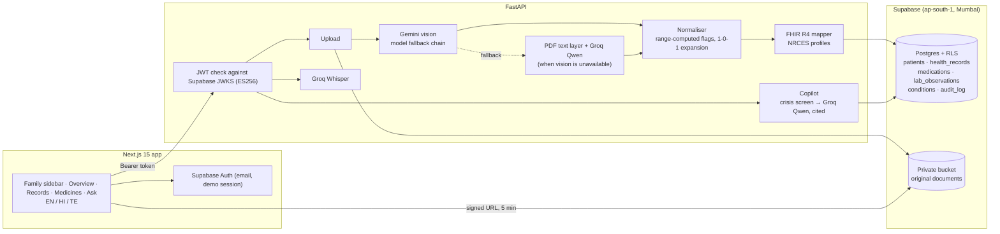

# Health Copilot

Reads a family's prescriptions, lab reports and discharge summaries, explains them in plain English, Hindi and Telugu, and keeps one ABDM-aligned FHIR R4 record per person.

Built for the Altrix Labs "AI-Powered Personal Health Copilot" challenge.

## What it does

- **Reads documents.** Photos (including handwriting-style and Hindi/Telugu bilingual prescriptions) and PDFs go through Gemini vision. Medicines, doses, timing, duration, test values, reference ranges, diagnoses, doctor, facility and dates are extracted.
- **Checks the numbers.** Every HIGH/LOW flag is recomputed from the reference range printed on the report, so the AI's own guess never decides whether a value is abnormal.
- **Explains in plain words.** A short summary, a one-line meaning for each out-of-range value, and questions to ask the doctor, in English, Hindi and Telugu.
- **Keeps people apart.** One caregiver account manages several family members. If the name on a document does not match the person it was added to, the app says so and offers to move it.
- **Refuses what it should.** Non-medical uploads are rejected. If extraction fails nothing is saved; there is no invented fallback data.
- **Shows the source.** Each record opens beside the original document so every value can be checked.
- **Answers questions.** A per-person assistant answers only from that person's records, cites the records it used, and routes self-harm or emergency questions to 112 / 108 / Tele-MANAS before any model is called.
- **ABDM-ready.** Each document becomes an NRCES-profile FHIR R4 document bundle (Composition, Patient with ABHA identifier, Practitioner, Organization, Condition, MedicationRequest, Observation, DiagnosticReport). ABHA linking is a format-validated mock; a person's full record exports as a FHIR collection.

## Architecture



### Data model

`supabase/migrations/20261012170000_health_copilot.sql`

| Table | Holds |
|---|---|
| `patients` | Family members owned by one account, with ABHA number/address |
| `health_records` | Full extraction (three languages), extraction metadata, FHIR bundle, storage path |
| `medications`, `lab_observations`, `conditions` | Normalised rows per record for querying and trends |
| `audit_log` | Uploads, views of originals, moves, deletes, ABHA links, exports |

Every row carries `owner_id`; row-level security limits each signed-in account to its own family. Originals live in a private bucket at `<owner_id>/<record_id>` and are served through short-lived signed URLs.

## Run it

Backend (Python 3.12):

```bash
cd backend
python3.12 -m venv venv && ./venv/bin/pip install -r requirements.txt
cp .env.example .env   # fill in Gemini, Groq and Supabase values
./venv/bin/uvicorn app.main:app --port 8000
```

Database:

```bash
supabase link --project-ref <ref>
supabase db push
```

Frontend:

```bash
cd frontend
npm install
# .env.local: NEXT_PUBLIC_BACKEND_URL, NEXT_PUBLIC_SUPABASE_URL, NEXT_PUBLIC_SUPABASE_PUBLISHABLE_KEY
npx next dev -p 3010
```

Set `DEMO_EMAIL` and `DEMO_PASSWORD` in `backend/.env` to enable the "Use the demo family" button. The password never reaches the browser.

## Demo script

1. Sign in with the demo family. Lakshmi Devi's overview shows three values outside their printed ranges on range bars, and her medicine schedule.
2. Open her lab report: original on the left, results with plain-language meanings on the right. Switch to తెలుగు.
3. Ask: "Which results are not normal?" The answer cites the lab report.
4. Upload `docs/sample-documents/live-demo_suresh_yadav_hindi_prescription.png` to Venkata Rao. The app reads the Hindi, flags that the document names Suresh Yadav, and adds him to the family in one click.
5. Upload `live-demo_not_a_medical_document.png`. It is refused and nothing is saved.
6. Link an ABHA number and export the FHIR R4 record.

## Safety

- Not a diagnostic tool. No dose-change advice; a disclaimer is shown on every screen in the selected language.
- Abnormal flags come from the printed reference range, not from the model.
- Values the model marked hard to read are labelled "check the original".
- Emergency and self-harm wording is answered with 112, 108 and Tele-MANAS (14416) by deterministic rules before any model call.
- All sample people and documents are synthetic (`docs/sample-documents/`).

## Limitations

- ABHA linking validates format only; there is no ABDM gateway, consent manager or HIP/HIU integration.
- FHIR codes use text where no verified SNOMED CT / LOINC code was available.
- Extraction quality depends on Gemini availability; when the primary model is busy the chain falls back to lighter models.
