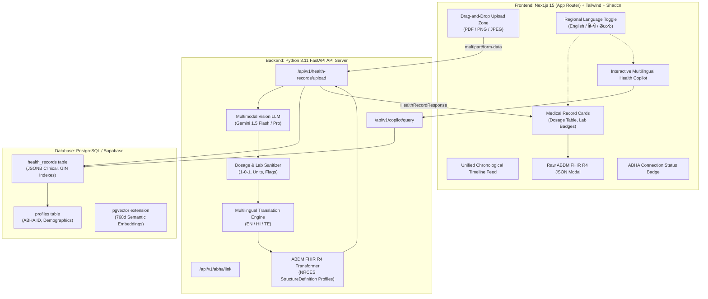

# AI-Powered Personal Health Copilot

An enterprise-grade, hackathon-ready clinical application designed to transform fragmented, unstructured medical documents—such as doctor prescriptions, diagnostic lab reports, and hospital discharge summaries—into structured clinical data, multilingual plain-language patient summaries (English, Hindi, and Telugu), and fully compliant **Ayushman Bharat Digital Mission (ABDM) FHIR R4** JSON bundles.

---

## 🏛️ System Architecture



---

## 📁 Repository Structure

```
Personal-Health-Copilot/
├── frontend/                     # Next.js 15 (App Router) + Tailwind CSS + Shadcn UI
│   ├── app/
│   │   ├── layout.tsx            # Root layout with navbar & ABHA badge
│   │   ├── page.tsx              # Main Dashboard (Upload + Timeline Feed + AI Copilot)
│   │   └── globals.css           # Tailwind CSS directives & color tokens
│   ├── components/
│   │   ├── ui/                   # Shadcn UI primitives (Button, Card, Dialog, Badge, Select, Skeleton)
│   │   ├── upload-zone.tsx       # Drag-and-drop document upload interface with progress bar
│   │   ├── timeline-feed.tsx     # Chronological health timeline wrapper with search & filters
│   │   ├── record-card.tsx       # Medical record card with dosage & test table
│   │   ├── fhir-modal.tsx        # Raw ABDM FHIR R4 JSON bundle inspector modal
│   │   ├── language-switcher.tsx # Regional language toggle (English/Hindi/Telugu)
│   │   ├── abha-header.tsx       # ABHA ID link status badge & consent dialog
│   │   └── navbar.tsx            # Navigation header component
│   ├── lib/
│   │   ├── api-client.ts         # Fetch client with 5s timeout & live-demo safety fallback
│   │   ├── mock-cache.ts         # Local JSON fallback cache for uninterrupted judging
│   │   ├── language-context.tsx  # React context for reactive multilingual switching
│   │   └── utils.ts              # cn helper (clsx + tailwind-merge)
│   ├── package.json
│   ├── tsconfig.json
│   ├── tailwind.config.js
│   └── postcss.config.mjs
│
├── backend/                      # Python 3.11 FastAPI Application
│   ├── app/
│   │   ├── main.py               # FastAPI initialization & CORS setup
│   │   ├── config.py             # Environment configuration (Keys, DB URLs)
│   │   ├── routers/
│   │   │   ├── ingestion.py      # /api/v1/health-records/upload endpoint
│   │   │   ├── abha.py           # /api/v1/abha/link endpoint
│   │   │   └── search.py         # /api/v1/copilot/query vector search route
│   │   ├── services/
│   │   │   ├── ocr_engine.py     # Multimodal LLM Vision API caller (Gemini) & mock fallback
│   │   │   ├── fhir_mapper.py    # Standardized JSON to ABDM FHIR R4 transformer
│   │   │   ├── translator.py     # Multi-language summary generator (EN, HI, TE)
│   │   │   └── regex_cleaner.py  # RegEx dosage and lab range normalization
│   │   ├── schemas/
│   │   │   ├── fhir_templates/   # Standard ABDM R4 JSON bundle templates
│   │   │   │   ├── prescription.json
│   │   │   │   ├── diagnostic_report.json
│   │   │   │   └── discharge_summary.json
│   │   │   └── payloads.py       # Pydantic v2 models for API request/responses
│   ├── requirements.txt          # fastapi, uvicorn, google-generativeai, pydantic, supabase
│   └── .env.example              # Environment variables template
│
├── database/                     # PostgreSQL / Supabase Migration Scripts
│   ├── schema.sql                # SQL schema creation script (tables, pgvector, indexes)
│   └── seed.sql                  # Initial mock patient records for testing
│
└── README.md                     # System architecture & setup instructions
```

---

## ⚡ Quickstart Guide

### 1. Prerequisites
- **Node.js** >= 18.18.0 or 20.x
- **Python** >= 3.10 (3.11 recommended)
- **Git**

---

### 2. Backend Setup (FastAPI)

```bash
# Navigate to backend directory
cd backend

# Create and activate virtual environment
python -m venv venv

# On Windows (PowerShell):
.\venv\Scripts\Activate.ps1
# On macOS/Linux:
source venv/bin/activate

# Install dependencies
pip install -r requirements.txt

# (Optional) Setup environment variables
cp .env.example .env
# Edit .env to add your GEMINI_API_KEY (optional; system includes offline fallback mode)

# Start FastAPI server
uvicorn app.main:app --host 0.0.0.0 --port 8000 --reload
```

- Backend interactive API docs will be accessible at: `http://localhost:8000/docs`
- Healthcheck endpoint: `http://localhost:8000/health`

---

### 3. Frontend Setup (Next.js 15)

```bash
# Navigate to frontend directory
cd frontend

# Install dependencies
npm install

# Start development server
npm run dev
```

- Frontend application will be live at: `http://localhost:3000`

---

### 4. Database Setup (Supabase / PostgreSQL)

1. Open your Supabase SQL Editor or standard PostgreSQL CLI.
2. Execute [`database/schema.sql`](file:///c:/Users/venka/Desktop/Personal-Health-Copilot/database/schema.sql) to establish the tables, foreign keys, GIN indexes, and pgvector extension.
3. Execute [`database/seed.sql`](file:///c:/Users/venka/Desktop/Personal-Health-Copilot/database/seed.sql) to populate initial mock patient records with abnormal diagnostic markers and prescription dosages.

---

## 🛡️ ABDM FHIR R4 Compliance Highlights

The platform adheres strictly to National Resource Centre for EHR Standards (NRCES) India and Ayushman Bharat Digital Mission (ABDM) FHIR R4 Bundle profiles:

| Resource Type | NRCES StructureDefinition Profile | Purpose |
|---|---|---|
| **Prescription** | `.../StructureDefinition/PrescriptionRecord` | Encapsulates `MedicationRequest`, instructions, doctor details |
| **DiagnosticReport** | `.../StructureDefinition/DiagnosticReportRecord` | Encapsulates lab parameters, reference intervals, `Observation` interpretation (`HIGH`, `LOW`, `NORMAL`) |
| **DischargeSummary** | `.../StructureDefinition/DischargeSummaryRecord` | Inpatient hospital course, condition diagnoses, care plan |
| **Patient** | `.../StructureDefinition/Patient` | Verified ABHA ID (`91-XXXX-XXXX-XXXX`) linkage |
| **Composition** | HL7 FHIR Document Composition | Master narrative index pointing to entries |

---

## 🚀 Live Demo & Hackathon Safety Features

1. **5-Second Timeout Fallback**: If the backend is not started or external AI services experience rate limits, [`frontend/lib/api-client.ts`](file:///c:/Users/venka/Desktop/Personal-Health-Copilot/frontend/lib/api-client.ts) automatically falls back to [`frontend/lib/mock-cache.ts`](file:///c:/Users/venka/Desktop/Personal-Health-Copilot/frontend/lib/mock-cache.ts) after 5 seconds so live demos never fail during judging.
2. **1-Click Sample Preset Buttons**: The upload zone includes "+ Sample Lab Panel" and "+ Sample Rx Prescription" buttons to test real-time timeline ingestion with zero file prep.
3. **Multilingual Toggle**: Instant switching between English, Hindi (`हिंदी`), and Telugu (`తెలుగు`) translates patient summaries and copilot answers dynamically.
4. **Interactive FHIR Inspector**: Every record card features a "View ABDM FHIR R4 JSON" button opening a syntax-highlighted inspector modal with copy and download utilities.
